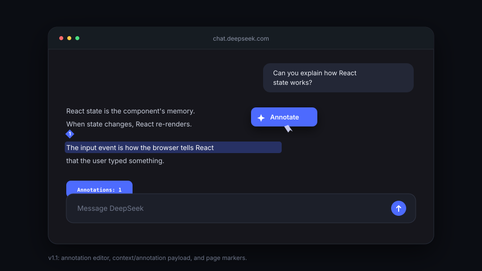

# Annotate for DeepSeek

A small Firefox/Zen extension that adds the missing "Ask ChatGPT"-style selection action to DeepSeek Chat: highlight text, click **Annotate**, and it becomes a hidden annotation attached to your prompt.



## Features

- Highlight text on `chat.deepseek.com` and click **Annotate**.
- A small `Annotations: N` tag appears above the prompt box; click it to review or remove annotations.
- Annotations attach to your message when you send — no copy-paste.

## Install

Requires Firefox 142+ or a recent Zen build.

1. Download or clone this repo.
2. Open `about:debugging#/runtime/this-firefox`.
3. Click **Load Temporary Add-on…**.
4. Pick `manifest.json` from this folder.
5. **Refresh any open `chat.deepseek.com` tab** so the content script is injected.
6. Select text, click **Annotate**, then type and send your question.

Temporary add-ons disappear when the browser closes.

### Flatpak Firefox/Zen

Flatpak's file picker can expose only the selected file, so `manifest.json` may load without `src/`, `icons/`, or `popup/`. Build and load the zip instead:

```sh
npx web-ext build --source-dir . --artifacts-dir dist --overwrite-dest
```

Then choose `dist/annotate_for_deepseek-1.0.0.zip` in **Load Temporary Add-on…**.

## Development

No build step. Edit `src/content.js` or `src/content.css`, reload the extension in `about:debugging`, and refresh the DeepSeek tab.

How it works: the content script stores each selection in memory as an annotation.
A small `Annotations: N` tag appears above the prompt box; click it to review or remove.
On send, the annotation text is appended to the message and the tag clears.
If automatic sending fails, the text stays visible in the prompt so you can send it manually.
No background script, no permissions, no network.
